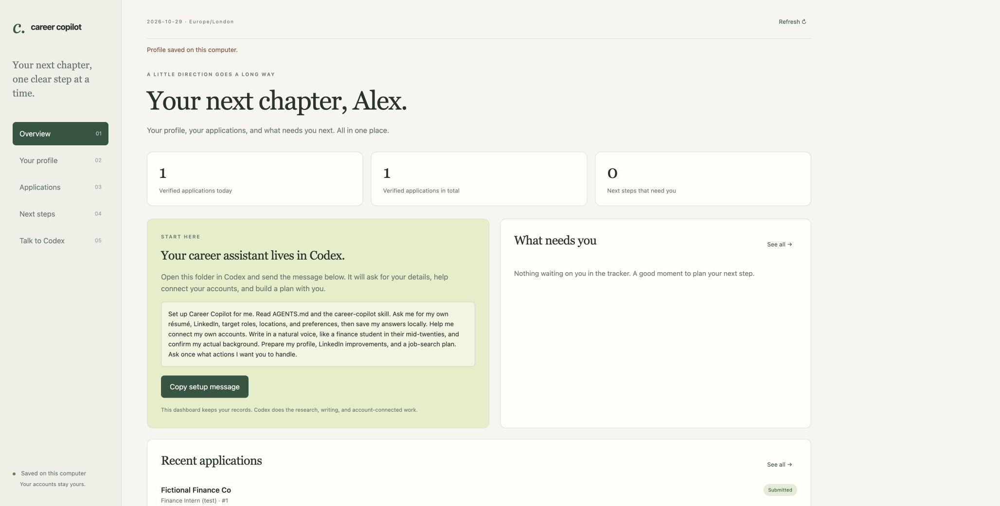

# Career Copilot

Your own career assistant in Codex: résumé and LinkedIn help, suitable jobs, application tracking, reply checks, and a clear list of what needs you next.

Built for a natural, early-career voice. The starting writing preference is a finance student in their mid-twenties: clear, specific, and human, without corporate filler or made-up experience. The assistant asks for **your** actual background and remembers your answers locally.



*Preview uses a fictional candidate and synthetic receipt; no real application was submitted.*

## Start in Codex

1. [Download this repo as a ZIP](https://github.com/LeonKelvinLi/career-copilot/archive/refs/heads/main.zip) and unzip it, or clone it:
   ```sh
   git clone https://github.com/LeonKelvinLi/career-copilot.git
   ```
2. Open the `career-copilot` folder as a project in Codex. Start a chat in that project.
3. Send:

   > Set up Career Copilot for me. Read AGENTS.md and the career-copilot skill. Ask me for my own details and walk me through setup.

Codex will ask for your résumé (or pasted experience), LinkedIn URL if you have one, target roles, work locations, and preferences. It will build your profile, save your answers, and help you connect your own accounts. You don't need to send those details to the person sharing this repo.

If Codex doesn't discover the skill automatically, ask it to read `.agents/skills/career-copilot/SKILL.md` directly. Project guidance and skills are supported through the mechanisms described in the [official Codex customization docs](https://learn.chatgpt.com/docs/customization/overview).

## What you can say

- “Any replies?”
- “What's outstanding on my part?”
- “Find finance internships that fit my profile.”
- “Improve my LinkedIn and make it sound like me.”
- “Help tailor my résumé for this role.”
- “Make this shorter and less corporate.”
- “Set up a daily job-search routine.”

Codex does the research and writing using the tools available in **your** session. It checks what you've authorized before submitting applications, publishing profile changes, or sending messages. It saves meaningful sources and distinguishes receipts, assessments, interviews, rejections and recruiter outreach. Your own video recordings, scored assessments and identity checks stay with you.

## Optional dashboard

The local dashboard gives you a profile editor, application tracker, next steps, and messages you can copy into Codex. Python 3.10+ is required. There are no JavaScript packages or API keys to install.

```sh
python3 career.py init
python3 career.py serve --open
```

On Windows, use `py -3` instead of `python3` if needed. The dashboard opens at [127.0.0.1:8765](http://127.0.0.1:8765). Keep the terminal running; press Ctrl+C to stop. It only listens on your computer. Some Windows/Python installations need `py -3 -m pip install tzdata` for named timezones.

The dashboard and CLI store records. **They do not independently read email, use AI, submit applications, or run a schedule.** Those actions happen in Codex with your connected tools. Account availability depends on your Codex environment; an unavailable connection does not block profile drafts. This repo does not include someone else's accounts or a transferable login. Your friend sharing the repo cannot sign into your services for you.

## How your data is saved

Your profile, application records, sources, drafts, memory and receipts belong in `private/`, which is ignored by Git. Nothing from the creator's personal profile or application history is included. The local data is **not encrypted**; use your computer's normal account and disk protections. If you share the folder or a ZIP yourself, omit `private/`. Git-ignore protects ordinary Git commits, not manual uploads or force-adds.

The SQLite tracker keeps an event history. A verified submission requires an actual receipt or portal confirmation; uncertain submissions don't count. Changing a submitted role to an assessment or rejection doesn't count it again. Separate roles at one employer have separate records and next steps. Back up the whole `private/` folder while the dashboard is stopped if you want to keep your records elsewhere.

## CLI for Codex and power users

```sh
python3 career.py profile show
python3 career.py status
python3 career.py application --help
python3 career.py task --help
python3 career.py history
```

To import a profile, copy `profile.example.json` into `private/profile-draft.json`, fill it in, and run:

```sh
python3 career.py profile import --file private/profile-draft.json
```

Import replaces the complete profile. Start from `profile show` when updating an existing profile so you preserve facts, permissions and connection notes. Codex can do this for you.

## Checks

```sh
python3 -m unittest discover -s tests -v
```

Tests use temporary directories and fictional data. They don't access mail, LinkedIn or employer accounts. The isolated agent onboarding test is described in [docs/validation.md](docs/validation.md).

MIT licensed. Python standard library only; account-connected work uses your existing Codex environment.
